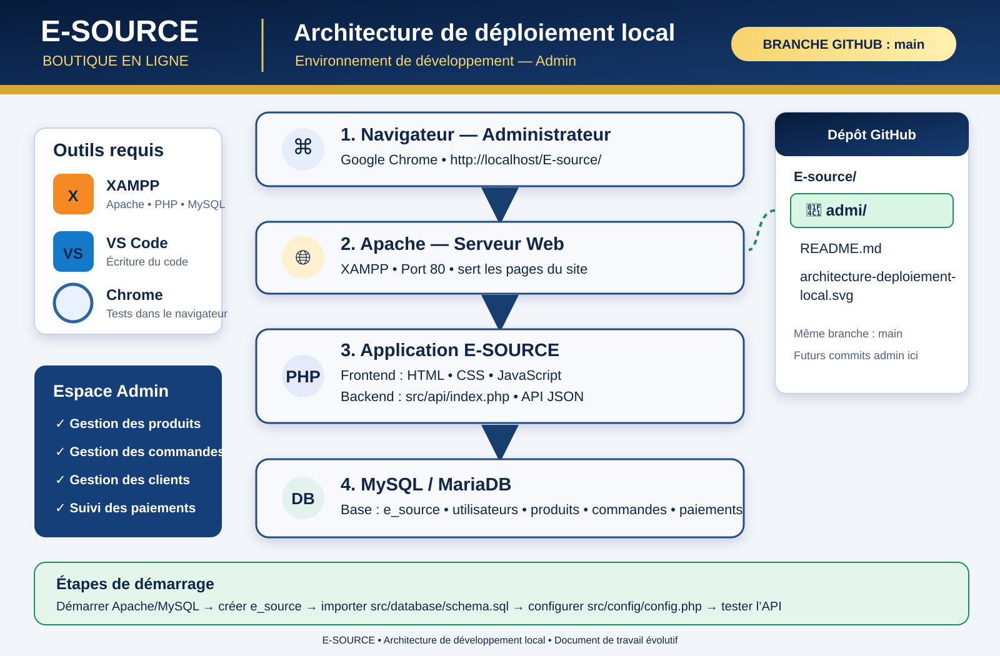

# E-SOURCE — Espace administrateur

Ce dossier est l'espace de travail réservé aux prochains développements de l'interface d'administration.

## Architecture de déploiement local

### Environnement recommandé
- **XAMPP** : Apache, PHP 8.1+ et MySQL/MariaDB.
- **Navigateur** : Google Chrome.
- **Éditeur** : Visual Studio Code.
- **Projet** : placer le dépôt dans `C:\\xampp\\htdocs\\E-source\\`.

### Flux applicatif
1. L'administrateur ouvre `http://localhost/E-source/` dans son navigateur.
2. Apache (port 80) sert les fichiers HTML, CSS et JavaScript.
3. Le frontend communique avec l'API PHP située dans `src/api/index.php`.
4. L'API utilise la base MySQL `e_source`.

### Mise en route
1. Démarrer Apache et MySQL dans XAMPP.
2. Créer la base `e_source` avec l'interclassement `utf8mb4_unicode_ci`.
3. Importer `src/database/schema.sql` dans phpMyAdmin.
4. Copier `src/config/config.example.php` vers `src/config/config.php`, puis configurer les identifiants MySQL locaux.
5. Tester : `http://localhost/E-source/src/api/index.php?action=health`.

### Périmètre administrateur à développer
- Tableau de bord et indicateurs.
- Gestion des produits, catégories et stocks.
- Gestion des commandes et de leurs statuts.
- Gestion des clients et des autorisations de crédit.
- Suivi des paiements.

### Sécurité
- Ne jamais commiter `src/config/config.php`, les mots de passe ou les secrets.
- Conserver les contrôles de rôle administrateur côté serveur.
- Ne pas exposer phpMyAdmin ni le serveur local sur Internet.
- Prévoir des sauvegardes régulières de la base.

> État du projet : l'API PHP/MySQL existe déjà, mais les écrans d'administration et leur raccordement au frontend restent à construire. Ce dossier sert de point de départ aux prochains commits.
